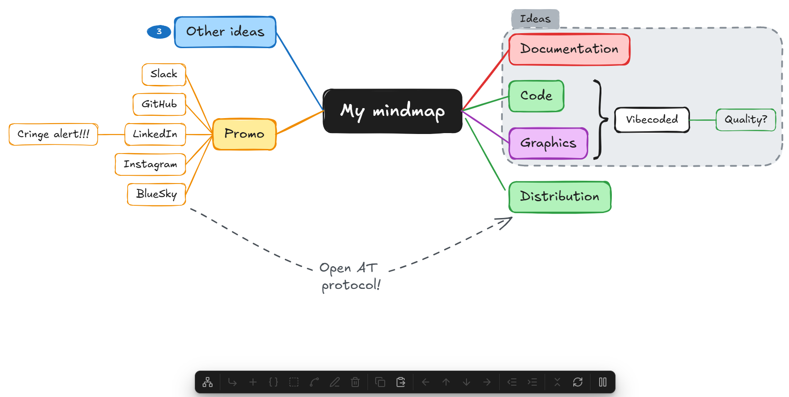

# Excalidraw Mind Map

Obsidian plugin that adds XMind-style mind map editing to Excalidraw drawings. Requires the Excalidraw plugin.



## Usage

Open a drawing and click **New mind map** in the floating panel, or run the command "Insert new mind map".

| Key | Action |
|---|---|
| Tab / Insert | Add child |
| Enter | Add sibling below |
| Shift+Enter | Add sibling above |
| Delete / Backspace | Delete the selected topics with their subtopics (the central topic deletes the whole map, if enabled in settings; a central topic with no other topics can always be deleted), or the selected boundary or callout |
| Ctrl+C / Ctrl+X | Copy or cut the selected topics as a Markdown bullet list |
| Ctrl+V | Paste a Markdown outline or text as subtopics of the selected topic |
| Ctrl+D (Cmd+D on Mac) | Duplicate the selected topics with their subtopics (the central topic duplicates the whole map) |
| F2 / Space | Edit the text of the topic, or of the selected boundary's title or callout (Enter too for these two) |
| Arrow keys | Move selection (right/left = child/parent, mirrored on the left side) |
| Alt+Up / Alt+Down | Move the topic, or the selected boundary with its topics, up or down among its siblings. It stays in its boundaries and summaries, and moves past one it isn't in as a whole; drag it to take it in or out |
| Alt+Left / Alt+Right | Promote or demote the topic (toward or away from the central topic, mirrored on the left side) |
| Ctrl+/ (Cmd+/ on Mac) | Collapse or expand the topic |

## Key Features

### ⌨️ Keyboard-first editing

Build a whole map without touching the mouse, with the shortcuts you know from XMind. Add children and siblings, edit text, duplicate and delete branches, move between topics and reorder them. While editing, Enter commits the text and Tab commits it and adds a child.

### 📐 Automatic layout

The map re-arranges itself after every change, and after every drop: subtopics always follow their topic. The **Layout settings** button in the panel (in its **⋯** menu on phones and tablets) sets the map's structure and auto-align, and resets the layout or, with **Reset all**, the whole map.

With **Auto-align** on, every topic keeps its automatic place, evenly spaced. Dropping a topic moves it among its siblings by the height you drop it at. With it off, a dropped topic stays where you put it, until you reset the layout. Each map has its own; new maps take the default from the settings, and maps made before version 1.2 have it off.

### 🧭 Structures

Each map has its own structure, chosen from the panel's layout settings or with the command "Change structure of the mind map". It applies to the map of the selected topic; when the drawing has only one map, nothing needs to be selected.

- **Balanced**: main topics are split evenly between the right and left side, clockwise from the top right, like XMind's balanced map. A boundary or summary of main topics keeps them on one side, even if that leaves the sides a topic or two apart. Drag a main topic across the central topic and it moves to that side, trading places with a topic there to keep the balance.
- **Free**: each main topic stays on the side you put it on. Drag a main topic across the central topic to move it to the other side; it stays there.
- **Right** and **Left**: all main topics on one side.

New maps get the structure set in the settings. Maps made before version 1.2 are free.

### 🧩 Summaries, boundaries and relationships

Select sibling topics to add a **summary**, a topic behind a brace that spans them; drag a topic above or below the brace to take it out, or next to the brace to add it. Or add a **boundary**, a dashed frame with a title around them; select it and press Space or Enter to edit its title, or Delete to remove it, leaving its topics. Drag a topic out of the frame to take it out of the boundary, or drag a sibling in to add it. The frame and its title are grouped, so clicking either selects both and they move together; move them to move the topics along, even to the other side. To resize the frame alone, double-click into the group and select it: it then takes in exactly the topics inside it. A **relationship** is a curved, labeled arrow between any two topics or boundaries, even in different maps, and it stays attached when they move. Drag either end onto another topic or boundary to reconnect it.

### 💬 Callouts

A **callout** is a short note in a solid-colored bubble right above a topic, with a tail pointing down at it, like XMind's callout. Add one from the panel or with the command "Add callout to selected topic"; it opens for typing right away. Enter finishes it, Shift+Enter starts a new line. The bubble and its tail are grouped, so they are selected together; the callout moves with its topic and the map makes room for it. Select it and press Space or Enter to edit it, or Delete to remove it; a callout edited to no text is removed too. A topic has at most one callout (adding another edits the one it has), summaries have none, and it goes when its topic is deleted. Duplicating a topic copies its callout too.

### 🪗 Collapse and expand

Ctrl+/ collapses a topic with everything below it. A badge shows how many topics are hidden, and clicking it expands the topic again. On the central topic, it collapses or expands all main topics at once.

### ↔️ Promote and demote

Alt+arrow moves a topic, with its subtopics, one level up or down. A topic that becomes a main topic takes the next branch color, and one that moves under another branch takes that branch's color.

Or drag a topic onto another one to make it a subtopic there, in one move. The topic it lands on is outlined while you drag; drop it near a topic's top or bottom edge instead to place it between topics. Dropped on the central topic, it becomes a main topic on that side. Drop it on a topic of another map to move it into that map; drag a map's central topic onto another map's topic to make the whole map a branch there.

### 📝 Markdown outlines

Ctrl+C copies the selected topics as a Markdown bullet list, ready to paste into a note; callouts are left out. Ctrl+V pastes bullet lists, numbered lists or headings back as subtopics of the selected topic. A command builds a whole new map from the outline in the clipboard.

### 🔗 Links to notes

Type `[[` in a topic to open Excalidraw's link suggester for notes, headings, blocks and tags. Ctrl+click the topic to open the note. Links are kept when topics are copied as Markdown and pasted back.

### 🎨 Themes and your colors

Each map has its own **theme**, picked from the panel's **Theme** button (in its **⋯** menu on phones and tablets) or with the command "Change theme of the mind map". The built-in ones are **Classic**, **Pastel**, **Ocean**, **Sunset**, **Forest** and **Monochrome**; your own themes follow them. Changing it recolors the whole map at once and keeps its layout. New maps get the theme set in the settings.

Make your own themes on the **Themes** page of the settings: add one starting from any theme, then pick the colors of its central topic, branches, summaries, boundaries, relationships and callouts. Export all of them as JSON to the clipboard or to a file in the vault, and import them in another vault, from the clipboard or a file. **Reset all** restyles a map with its theme's colors.

### 📱 Works on mobile

A floating panel offers every action. On phones and tablets it keeps the buttons that add, edit and delete topics, summaries, boundaries and relationships, and puts the rest, callouts and themes among them, in its **⋯** menu so it fits the screen. You can build maps without a keyboard.

The panel comes in several styles, chosen in the settings: **Default** like Obsidian's own toolbars, **Accent color**, **High contrast** (dark in a light theme, light in a dark one), **Translucent** over the drawing, or **Colorful icons**.

### ✏️ Still plain Excalidraw

Maps are ordinary Excalidraw elements, so every Excalidraw tool still works on them. Every operation is a single undo step. Pause the plugin from the panel, or with the command "Pause or resume mind map editing", when you want Excalidraw's own shortcuts back.

## Configuration

All options are in **Settings → Excalidraw Mind Map**.

| Setting | Default | Description |
|---|---|---|
| Show control panel on desktop | On | Shows the floating panel on desktop. On phones and tablets it is always shown. |
| Control panel position | Bottom | A row at the bottom or top of the drawing, or a column on its left or right side. On phones, Bottom shows it at the top, clear of Excalidraw's own toolbars. |
| Control panel style | Default | How the panel looks: Default, Accent color, High contrast, Translucent or Colorful icons. |
| Allow deleting the central topic | Off | Lets Delete remove the central topic, which deletes the whole map: every topic and connector. A central topic with no other topics can be deleted either way. |
| Structure of new maps | Balanced | How main topics are placed around the central topic: balanced, free, right or left. Each map keeps its own. |
| Auto-align new maps | On | Topics keep their automatic places and a drop moves a topic among its siblings, instead of leaving it where it is dropped. Each map keeps its own. |
| Theme of new maps | Custom | The colors of new maps: a built-in theme or one of your own. Each map keeps its own. |
| Arrows instead of lines | Off | Connectors end in an arrowhead pointing to the subtopic. |

**Themes** are on their own page in the settings. You start with one, **Custom**, which has the colors you set before themes existed and which maps made before then use. Add a theme starting from a built-in one or one of yours, reorder them, and rename or delete one from its page. Each theme has colors for:

- the central topic: text, border and background
- the topic text of main topics and subtopics
- summaries: text, border and brace, background
- boundaries: dashed line, background, title text, title background
- relationships: line and arrowhead, label text
- callouts: text, background and tail
- branches: line and border, and main topic background. Main topics take the branch colors in turn. Branch colors can be added, removed and reordered, and **Reset colors to defaults** restores the original palette.

**Import and export** exports all your themes as JSON, to the clipboard or a file in the vault, and brings themes in from the clipboard or a file. A map whose theme was deleted, or comes from another vault, gets the Classic colors for new topics.

Color and arrow changes apply to topics and connectors created afterwards. To apply them to an existing map, pick its theme again from the panel, or use **Reset all** from the panel's layout settings or the command palette.

## Development

```
npm install
npm run dev     # watch build, copies into test-vault/.obsidian/plugins/excalidraw-mindmap
npm run build   # type-check + production build
npm test        # unit tests
npm run lint    # ESLint with Obsidian's plugin rules
```

To install into a vault manually, copy `main.js`, `manifest.json` and `styles.css` from the [latest release](https://github.com/Dzoukr/ExcalidrawMindmapObsidianPlugin/releases/latest) into `<vault>/.obsidian/plugins/excalidraw-mindmap/`.

## License

[MIT](LICENSE)
